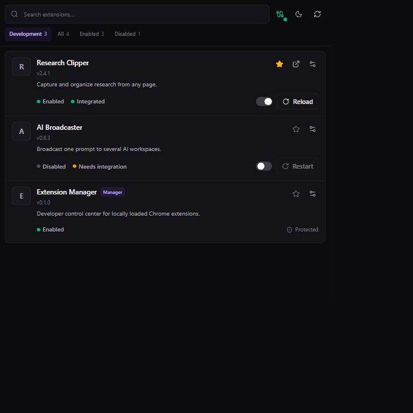

<p align="center"></p>

# Extension Manager

A persistent Chrome side panel for the extensions you are actively building.



_The UI preview uses fixture extension data._

Instead of returning to `chrome://extensions` to find the same unpacked extension, Extension Manager keeps its state and controls beside the page you are testing. Search by name, ID, description, or tag; enable and disable extensions; open their options; and restart or reload them from one list.

Chrome's management API can enumerate and toggle installed extensions. It cannot directly reload a different extension. Extension Manager makes that boundary visible:

| Target                         | Action      | What happens                                                                      |
| ------------------------------ | ----------- | --------------------------------------------------------------------------------- |
| Standard unpacked extension    | **Restart** | The manager disables and re-enables it through `chrome.management`.               |
| Extension using the target SDK | **Reload**  | The target reloads itself, then the manager pings it until it is reachable again. |

No integration is required for inventory, search, metadata, enable/disable, options links, favorites, tags, or manual restart.

## Build and open the side panel

Requirements: Node.js 22+, Corepack, and Google Chrome 114+.

```powershell
corepack pnpm install
corepack pnpm --filter @extension-manager/manager-extension build
```

Then:

1. Open `chrome://extensions` and enable **Developer mode**.
2. Choose **Load unpacked**.
3. Select `apps/manager-extension/.output/chrome-mv3`.
4. Pin Extension Manager and click its toolbar icon.

The default filter shows extensions loaded with `installType === "development"`. Switch to **All** when you need the rest of the installed inventory.

## Add verified reloads

Reliable reload is cooperative because Chrome does not provide a cross-extension reload API.

1. Add `@extension-manager/target` to the extension you are developing.
2. Allow the manager's stable ID: `gpmlcdigokplenooecjmlphknhaidnjf`.
3. Register the target listener in the extension's background entrypoint.

The exact WXT example and message contract are in [Target integration](docs/TARGET_INTEGRATION.md). An integrated fixture lives in `fixtures/integrated-target-extension`.

The reload sequence is deliberately bounded:

```text
manager sends RELOAD_EXTENSION
  → target acknowledges
  → target calls chrome.runtime.reload()
  → manager retries PING
  → UI reports reachable or timed out
```

## Native companion

The native companion transport and installers are implemented. Today it reports connection health; project pairing, process control, build commands, file watching, and log streaming are not shipped yet.

Windows installation:

```powershell
& apps/native-host/scripts/install-windows.ps1
```

See [Native host setup](docs/NATIVE_HOST_SETUP.md) for macOS, Linux, Chromium, and uninstall instructions.

On Windows, stop a running `native-host.exe` before rebuilding it. Windows locks the executable and the SEA packaging step will otherwise fail with `EBUSY`.

## What is implemented

- Live inventory from `chrome.management.getAll()`, refreshed on install, uninstall, enable, and disable events
- Development/all/enabled/disabled filters, full-text search, favorites, and tags
- User-initiated enable/disable and restart actions with self-protection for the manager
- Target SDK with sender validation, acknowledged reload, and bounded health checks
- Native messaging transport with validated length-prefixed frames and reconnect state
- Compact light/dark/system interface built for Chrome's resizable side panel

## Validate changes

```powershell
corepack pnpm format
corepack pnpm lint
corepack pnpm typecheck
corepack pnpm test
corepack pnpm --filter @extension-manager/manager-extension build
```

Run the fixture-backed UI outside Chrome:

```powershell
corepack pnpm --filter @extension-manager/manager-extension preview
```

The preview starts on `http://127.0.0.1:4391` and uses mocked extension data. It does not exercise Chrome APIs.

## Current boundaries

- Non-integrated extensions can be restarted, not reliably reloaded.
- Project pairing, builds, watchers, logs, and dev-server controls remain pending.
- Optional tab refresh is not implemented.
- Automated tests cover domain, protocol, transport, and React component behavior; Chrome extension E2E coverage remains pending.

Deeper references: [architecture](docs/ARCHITECTURE.md), [implementation status](docs/IMPLEMENTATION_STATUS.md), and [security model](docs/SECURITY.md).

API behavior follows Chrome's official documentation for [`chrome.management`](https://developer.chrome.com/docs/extensions/reference/api/management), [`chrome.sidePanel`](https://developer.chrome.com/docs/extensions/reference/api/sidePanel), and [native messaging](https://developer.chrome.com/docs/extensions/develop/concepts/native-messaging).

If this replaces part of your `chrome://extensions` routine, star the repository so it is easy to find for the next extension you build.
